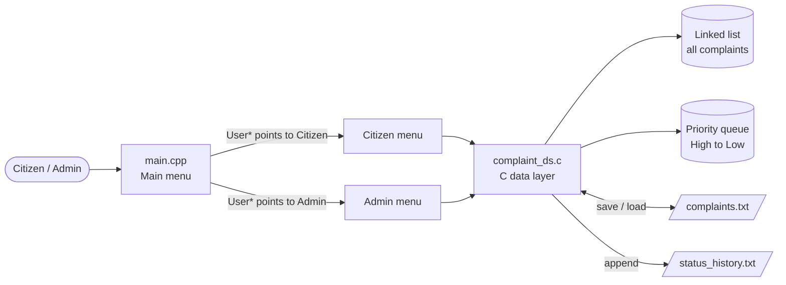
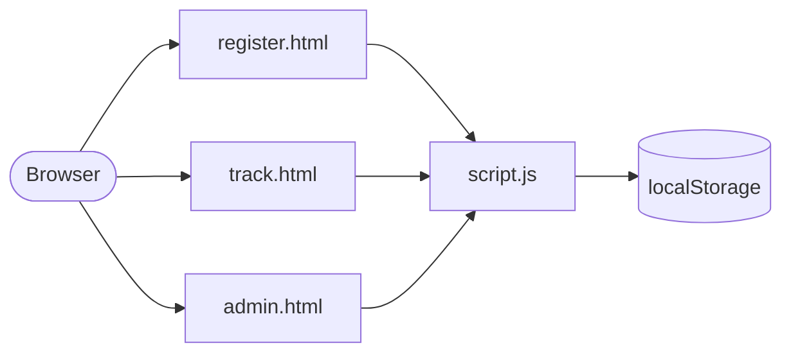

# Smart Public Complaint Analyzer

A complaint management system where citizens register public problems (potholes, water leaks, exposed wires, garbage, …), the system **automatically assigns a priority** from the complaint text, and an admin tracks, assigns and resolves complaints, highest priority first.

The core is a **C data layer** (linked list, priority queue, file handling) driven by a **C++ console application** (classes, inheritance, runtime polymorphism). A separate **HTML/CSS/JavaScript web prototype** demonstrates the same workflow in the browser.

| | |
|---|---|
| **Program** | Project-Based Learning (PBL), Phase-II |
| **Team ID** | DSCPP-III-2026-T031 |
| **Courses covered** | Data Structures in C · Object-Oriented Programming with C++ |
| **Department** | Computer Science & Engineering, Graphic Era (Deemed to be University), Dehradun |
| **Semester / Session** | 3rd semester, 2026-27 |
| **Mentor** | Dr. Prabhdeep Singh |

---

## Table of Contents

1. [Problem Statement](#problem-statement)
2. [Objectives](#objectives)
3. [Features](#features)
4. [Tech Stack](#tech-stack)
5. [Course Concepts Implemented](#course-concepts-implemented)
6. [System Architecture](#system-architecture)
7. [Data Structures](#data-structures)
8. [Automatic Priority Assignment](#automatic-priority-assignment)
9. [Project Structure](#project-structure)
10. [Getting Started](#getting-started)
11. [Usage Guide](#usage-guide)
12. [Data File Formats](#data-file-formats)
13. [Function Reference](#function-reference)
14. [Testing](#testing)
15. [Known Issues & Limitations](#known-issues--limitations)
16. [Project Status](#project-status)
17. [Roadmap (Phase-III)](#roadmap-phase-iii)
18. [Team & Contributions](#team--contributions)
19. [References](#references)
20. [License](#license)

---

## Problem Statement

Public complaint management often suffers from delays in **tracking**, **prioritization** and **department assignment**. Complaints are handled in arrival order instead of urgency, citizens cannot easily see what happened to their complaint, and administrators have no single view of pending work.

This project provides a centralized system that simplifies complaint registration, tracking, status updates and management.

## Objectives

1. Let citizens easily raise complaints and track their status.
2. Process, prioritize, sort, search and route complaints using C.
3. Apply **Data Structures in C** and **Object-Oriented Programming in C++** to a real problem.
4. Provide transparency and monitoring through an admin dashboard.

---

## Features

### Console application (C + C++)

**Citizen menu**
- **Register a complaint**: name, category, description and location.
  - Complaint ID is **generated automatically** (highest existing ID + 1).
  - Priority (**High / Medium / Low**) is **assigned automatically** from the description (see [Automatic Priority Assignment](#automatic-priority-assignment)).
  - New complaints start as `Pending`, with department and employee `Not Assigned`.
- **View all complaints**.
- **Search a complaint by ID** to check its status.

**Admin menu**
- **View all complaints**.
- **Update status** (`Pending` / `In Progress` / `Resolved`). Every status change is logged with a timestamp in `status_history.txt`.
- **Assign a department** and **assign an employee** to a complaint.
- **View the priority queue**: complaints ordered High → Medium → Low; equal priorities are served first-come, first-served.
- **Sort complaints by priority** (see [Known Issues](#known-issues--limitations) before using).
- **Dashboard / statistics**: total, pending, in-progress and resolved counts.
- **Filter complaints** by status or by category.

**System behaviour**
- All data is **saved to `complaints.txt` after every change** and reloaded on start-up; the priority queue is rebuilt from the loaded data.
- Non-numeric menu input is rejected without crashing (`cin.clear()` + `cin.ignore()`).
- All dynamically allocated memory (list and queue nodes) is freed on exit.

### Web prototype (`website/`)

| Page | What it does |
|---|---|
| `index.html` | Home page, how it works, complaint categories |
| `register.html` | Register a complaint (citizen ID, name, category, location, description). Shows the generated ID (starting at **1001**) and the priority |
| `track.html` | Look up a complaint by its numeric ID |
| `admin.html` | Search by ID / citizen ID / name / category / location / description, sort by newest or priority, change department and status, delete complaints |

- **Duplicate detection**: a new complaint with the same category, location and description (ignoring case and extra spaces) as an existing one is rejected, and the existing ID is shown.
- User text is rendered with `textContent`, never `innerHTML`, so typed input cannot inject HTML or scripts.
- Data is stored in the browser's `localStorage`.

> **Note:** The web prototype is **standalone**. It does not talk to the C/C++ program; the two keep separate data and use different priority rules. Connecting them is planned for Phase-III.

---

## Tech Stack

| Layer | Technology |
|---|---|
| Core data layer | C (C99 standard library: `stdio`, `stdlib`, `string`, `ctype`, `time`) |
| Application layer | C++11 (`iostream`, `string`, `limits`) |
| Storage | Plain text files (file handling) |
| Web prototype | HTML5, CSS3, vanilla JavaScript, browser `localStorage` |
| Compilers | GCC / G++ (MinGW on Windows), Clang on macOS |
| Editor | Visual Studio Code |
| Version control | Git / GitHub |

---

## Course Concepts Implemented

### Data Structures in C

| Concept | Where | How it is used |
|---|---|---|
| Structures | `ComplaintNode`, `PriorityNode` in `complaint_ds.h` | Group the 10 fields of a complaint into one record |
| Singly linked list | `ComplaintNode*` list in `complaint_ds.c` | Main store of all complaints; grows dynamically |
| Priority queue | `insertPriorityQueue()` | Sorted linked list of pointers, highest priority at the front |
| Arrays | `highKeywords[]`, `mediumKeywords[]`, `lowKeywords[]` | Keyword tables for priority detection |
| Dynamic memory | `malloc()` / `free()` | Every list and queue node is allocated at run time and freed on exit |
| Pointer to pointer | `addComplaint(ComplaintNode** head)` | Lets a function change the caller's `head` when the list is empty |
| Searching | `searchComplaint()`, `updateStatus()` | Linear search by complaint ID |
| Sorting | `sortComplaintsByPriority()` | Exchange-based sort on priority |
| File handling | `saveComplaints()`, `loadComplaints()`, `saveStatusHistory()` | Persistent storage and an append-only audit log |

### Object-Oriented Programming with C++

| Concept | Where | How it is used |
|---|---|---|
| Class & encapsulation | `Complaint` in `Complaint.h` | Private data members, public getters and a setter |
| Constructor with initializer list | `Complaint::Complaint(...)` | Builds a complaint object from the registered data |
| Abstraction | `User` in `main.cpp` | Abstract base class with pure virtual `displayMenu()` |
| Inheritance | `Citizen : public User`, `Admin : public User` | Each role provides its own menu |
| Runtime polymorphism | `User* currentUser` in `main()` | The same call `currentUser->displayMenu()` opens a different menu depending on the object |
| Virtual destructor | `virtual ~User()` | Safe destruction through a base-class pointer |
| C/C++ interoperability | `extern "C" { #include "complaint_ds.h" }` | C++ code calls the C data layer without name-mangling problems |
| Input validation | All menus in `main.cpp` | Recover from invalid (non-numeric) input |

---

## System Architecture



**Complaint lifecycle**

```
Register ──► Auto ID + auto priority ──► Pending ──► Department / employee assigned
                                            │
                                            ▼
                                       In Progress ──► Resolved
            (every status change is written to status_history.txt)
```

**Web prototype (separate)**



---

## Data Structures

```
head ──────────► [ #1 ] ──► [ #2 ] ──► [ #3 ] ──► NULL     linked list: owns the data, registration order
                    ▲          ▲          ▲
                    │          │          │
priorityFront ──► [ P ] ───► [ P ] ───► [ P ] ──► NULL     priority queue: pointers only, High → Low
```

The priority queue **stores pointers** to the complaints in the linked list instead of copies, so a status update is visible in both structures at once. (In practice the two orders differ: the list keeps registration order, while the queue is ordered by priority.)

### `ComplaintNode` (one complaint)

| Field | Type | Description |
|---|---|---|
| `complaintID` | `int` | Unique, auto-generated |
| `citizenName` | `char[100]` | Name of the citizen |
| `category` | `char[50]` | Road / Water / Electricity / Garbage / Other |
| `description` | `char[200]` | Problem description (used for priority detection) |
| `location` | `char[100]` | Where the problem is |
| `priority` | `char[20]` | `High` / `Medium` / `Low` (for display) |
| `priorityValue` | `int` | `3` / `2` / `1` (for comparisons) |
| `status` | `char[20]` | `Pending` / `In Progress` / `Resolved` |
| `department` | `char[50]` | Assigned department, default `Not Assigned` |
| `employee` | `char[50]` | Assigned employee, default `Not Assigned` |
| `next` | `ComplaintNode*` | Next complaint in the list |

### `PriorityNode` (one queue entry)

| Field | Type | Description |
|---|---|---|
| `complaint` | `ComplaintNode*` | Points to a complaint in the linked list |
| `next` | `PriorityNode*` | Next entry (equal or lower priority) |

---

## Automatic Priority Assignment

`assignPriority()` lowercases the description and checks keyword tables **in order**. The first match decides:

| Step | Rule | Result | Keywords | Examples |
|---|---|---|---|---|
| 1 | Description contains a **high** keyword | **High** (3) | 97 | fire, gas leak, exposed wire, building collapse, open manhole, flood |
| 2 | …else a **medium** keyword | **Medium** (2) | 100 | pothole, blocked drain, pipe leak, broken streetlight, garbage pile |
| 3 | …else a **low** keyword | **Low** (1) | 75 | faded paint, hairline crack, squeaky swing, torn poster |
| 4 | …else category is `road`, `water` or `garbage` | **Medium** (2) | n/a | fallback for unmatched civic problems |
| 5 | …otherwise | **Low** (1) | n/a | default |

Because High is checked first, a safety hazard is never ranked below a routine issue.

The web prototype uses a smaller rule set in `script.js` (`calculatePriority()`): 8 high words, 6 medium words, everything else Low.

---

## Project Structure

```
phase 2 pbl/
├── main.cpp               # C++ application: User/Citizen/Admin classes, menus, main()
├── Complaint.h            # C++ Complaint class (encapsulation demo)
├── complaint_ds.h         # C structures + function declarations
├── complaint_ds.c         # C data layer: linked list, priority queue, priority rules, file I/O
├── complaints.txt         # Saved complaints (created/updated by the program)
├── status_history.txt     # Status-change audit log (appended by the program)
├── website/
│   ├── index.html         # Home page
│   ├── register.html      # Complaint registration form
│   ├── track.html         # Track complaint by ID
│   ├── admin.html         # Admin panel
│   ├── script.js          # All web logic (localStorage, priority, duplicates, admin)
│   └── style.css          # Shared, responsive styling
├── .vscode/               # Editor configuration
└── README.md
```

**Generated files** (safe to delete, should not be committed): `*.o`, `*.exe`, `main`, `main_debug`, `*.dSYM/`, `.DS_Store`.

---

## Getting Started

### Prerequisites

- **Windows:** MinGW (`gcc` and `g++`) on your `PATH`
- **macOS:** Xcode Command Line Tools (`xcode-select --install`)
- **Linux (Debian/Ubuntu):** `sudo apt install build-essential`
- Any modern browser for the web prototype

### Build

The program has two source files that must be compiled separately and then linked: C code with a C compiler, C++ code with a C++ compiler.

**Windows (MinGW)**

```bash
gcc -c complaint_ds.c -o complaint_ds.o
g++ main.cpp complaint_ds.o -o SmartPublicComplaintAnalyzer.exe
```

**macOS / Linux**

```bash
gcc -c complaint_ds.c -o complaint_ds.o
g++ main.cpp complaint_ds.o -o SmartPublicComplaintAnalyzer
```

> Building only `main.cpp` (for example, VS Code's default *"build active file"* task) fails with *undefined reference* linker errors, because the functions live in `complaint_ds.c`. Use the two commands above.

### Run

Run the program **from the project folder**. It reads and writes `complaints.txt` and `status_history.txt` in the current directory; started from anywhere else, it begins with an empty list.

```bash
# Windows
SmartPublicComplaintAnalyzer.exe

# macOS / Linux
./SmartPublicComplaintAnalyzer
```

### Open the web prototype

Open `website/index.html` in a browser. No server or installation is needed.

---

## Usage Guide

### Menu reference

```
Main menu            Citizen menu                Admin menu
1. Citizen           1. Register Complaint       1. View All Complaints
2. Admin             2. View All Complaints      2. Update Complaint Status
3. Exit              3. Search Complaint         3. Assign Department
                     4. Back to Main Menu        4. Assign Employee
                                                 5. View Priority Queue
                                                 6. Sort Complaints by Priority
                                                 7. Dashboard / Statistics
                                                 8. Filter Complaints (by status / category)
                                                 9. Back to Main Menu
```

### Sample session

Captured from a real run starting with an empty data folder. User input is shown after each prompt; repeated menus are trimmed (`...`).

```
====================================
 SMART PUBLIC COMPLAINT ANALYZER
====================================
1. Citizen
2. Admin
3. Exit
Enter your choice: 1
...
Enter your choice: 1
System Assigned Complaint ID: 1
Enter Citizen Name: Aarav Sharma
Enter Category (Road/Water/Electricity/Garbage/Other): Road
Enter Description: Big pothole near the bus stop
Enter Location: Rajpur Road, Dehradun

System Assigned Priority: Medium

Complaint registered successfully!
Complaint ID: 1
Status: Pending
Department: Not Assigned

Complaint details confirmed.
Complaint ID: 1
Priority: Medium
Status: Pending
...
========== ADMIN MENU ==========
...
Enter your choice: 2
Enter Complaint ID: 1
Enter new status (Pending/In Progress/Resolved): In Progress

Complaint status updated successfully!
Old Status: Pending
New Status: In Progress
...
Enter your choice: 7

===== ADMIN DASHBOARD =====
Total Complaints : 1
Pending          : 0
In Progress      : 1
Resolved         : 0
===========================
```

---

## Data File Formats

### `complaints.txt`

One complaint per line, ten fields separated by `|`:

```
ID|Name|Category|Description|Location|Priority|PriorityValue|Status|Department|Employee
```

Example (written by the sample session above):

```
1|Aarav Sharma|Road|Big pothole near the bus stop|Rajpur Road, Dehradun|Medium|2|In Progress|Not Assigned|Not Assigned
```

The file is **rewritten completely** after every change (`"w"` mode).

### `status_history.txt`

An append-only audit log (`"a"` mode), one line per status change:

```
ID: 1 | Old: Pending | New: In Progress | Date: 2026-10-22 08:09:36
```

### Web prototype (`localStorage`)

| Key | Contents |
|---|---|
| `spca_complaints_v2` | JSON array of complaint objects (`id`, `citizenId`, `name`, `category`, `location`, `description`, `priority`, `department`, `status`, `date`) |
| `spca_next_complaint_id_v2` | Next complaint ID to hand out (starts at 1001) |

Data lives only in the browser that created it. Clearing site data deletes it.

---

## Function Reference

All functions are declared in `complaint_ds.h` and implemented in `complaint_ds.c`. *n* = number of complaints.

| Function | Purpose | Time |
|---|---|---|
| `addComplaint(ComplaintNode** head)` | Read input, generate ID, assign priority, append to list, save | O(n) |
| `displayComplaints(ComplaintNode* head)` | Print every complaint | O(n) |
| `searchComplaint(ComplaintNode* head, int id)` | Find and print one complaint | O(n) |
| `updateStatus(head, id, newStatus)` | Change status, log it, save | O(n) |
| `assignDepartment(head, id, newDepartment)` | Set department, save | O(n) |
| `assignEmployee(head, id, newEmployee)` | Set employee, save | O(n) |
| `insertPriorityQueue(PriorityNode** front, ComplaintNode* c)` | Sorted insert, stable for equal priorities | O(n) |
| `displayPriorityQueue(PriorityNode* front)` | Print queue from highest priority | O(n) |
| `sortComplaintsByPriority(ComplaintNode* head)` | Exchange sort by priority | O(n²) |
| `assignPriority(ComplaintNode* c)` | Keyword-based priority detection | O(k), k = keyword count |
| `saveComplaints(ComplaintNode* head)` | Write all complaints to file | O(n) |
| `loadComplaints(ComplaintNode** head)` | Read complaints from file | O(n²)* |
| `saveStatusHistory(id, oldStatus, newStatus)` | Append a timestamped log line | O(1) |
| `displayComplaintStatistics(ComplaintNode* head)` | Count by status | O(n) |
| `filterComplaintsByStatus(head, status)` | Print complaints with a given status | O(n) |
| `filterComplaintsByCategory(head, category)` | Print complaints in a given category | O(n) |

\* Each loaded line walks to the end of the list. Keeping a tail pointer would make this O(n).

Internal helpers (not in the header): `makeLowercase()` and `containsKeyword()`. `clearPriorityQueue()` is in `main.cpp`.

---

## Testing

### Phase-II results

| Module | Expected result | Observed result | Status |
|---|---|---|---|
| Registering complaints | Generation of complaint ID | ID generated successfully | ✅ Pass |
| Complaint tracking | Display of IDs | Successfully displayed | ✅ Pass |
| Status updation | Status updated | Success | ✅ Pass |

### Manual test checklist

- [ ] Register complaints with a high, a medium and a low keyword; check the assigned priority
- [ ] Restart the program; all complaints are reloaded
- [ ] Search for an existing ID and a non-existing ID
- [ ] Update a status; a line appears in `status_history.txt`
- [ ] Set a status to the value it already has; the message "Complaint already has this status" is shown
- [ ] Assign a department and an employee; both survive a restart
- [ ] View the priority queue; High comes before Medium before Low, and equal priorities keep their registration order
- [ ] Type letters at a menu prompt; the program recovers
- [ ] Check the dashboard counts against `complaints.txt`
- [ ] Filter by status and by category

---

## Known Issues & Limitations

### Bugs

| # | Issue | Effect | Suggested fix |
|---|---|---|---|
| 1 | `sortComplaintsByPriority()` swaps only the `priority` and `priorityValue` fields, not the whole complaint | Admin option 6 attaches priorities to the **wrong complaints** (e.g. "faded paint" becomes Medium and "pothole" becomes Low), and the next save writes this to disk | Swap all data fields except `next`, or relink the nodes. **Avoid option 6 until fixed**; option 5 already shows complaints in priority order |
| 2 | Typo `"landsklide"` in `highKeywords` | A plain "landslide" is not detected as High | Change it to `"landslide"` |
| 3 | An empty field, or a `\|` typed inside a field, breaks the line format | That complaint is **silently skipped** on the next load | Reject empty input and `\|` characters at registration |
| 4 | Input longer than a field's buffer (e.g. a 250-character description) | The extra characters are read as the answer to the next prompt | Discard the rest of the line after `fgets` |

### Limitations

- **Keyword matching is substring-based**: "firewood stall" contains "fire" and is rated High; negations such as "no fire" are not understood.
- **Category and status filters are case-sensitive**: filtering by `Road` does not show complaints saved as `road`.
- **Status is free text** in the console app: a value like `resolved` or `Done` is counted in the total but not in any dashboard bucket.
- **No duplicate detection** in the console app (only the web prototype has it).
- **No admin authentication**: anyone can open the admin menu or admin page.
- **No delete option** in the console app.
- Priorities saved in `complaints.txt` are **not recalculated** on load, so complaints saved by older versions of the rules keep their old priority.
- The **web prototype is not connected** to the C/C++ program (see [Features](#web-prototype-website)).
- In the web prototype, `"overflow"` is a High word, so `"overflowing"` matches High before the Medium list is checked.

---

## Project Status

As reported at the Phase-II evaluation (overall completion **66%**):

| Module | Status | Work completed |
|---|---|---|
| Complaint registration | ✅ Completed | Complaint ID generation |
| Complaint tracking | ✅ Completed | Searching by ID |
| Status and assignment | 🔄 In progress | Improving status |
| Duplicate detection | ⏳ Pending | Duplicate identification |

In the current code, the console app has status updates, department and employee assignment, and automatic priority. Duplicate detection exists only in the web prototype.

## Roadmap (Phase-III)

1. Complete the pending features.
2. **Integrate all modules into one system**, connecting the website to the C/C++ back end.
3. Test all features and fix errors, including the [known issues](#known-issues--limitations).
4. Create a fully working website.
5. Handle **duplicate complaints** in the core program.

---

## Team & Contributions

| Member | Role | Contribution |
|---|---|---|
| **Devraj Singh Rawat** | Lead | C module development, data structures |
| **Stuti Mahajan** | Developer | C module development, data structures |
| **Archi Panwar** | Web developer | Website and testing |
| **Rajat** | Developer | C++ module development (`main.cpp`) |

**Mentor:** Dr. Prabhdeep Singh

Department of Computer Science & Engineering, Graphic Era (Deemed to be University), Dehradun

---

## References

1. Data Structures and Algorithms: C Programming
2. C++ Programming Documentation
3. GeeksforGeeks: Linked Lists and Priority Queues
4. MDN Web Docs: HTML, CSS and JavaScript

---

## License

This project was created for academic purposes as part of the Project-Based Learning program at Graphic Era (Deemed to be University). No open-source license has been chosen yet.
